<p align="center">
  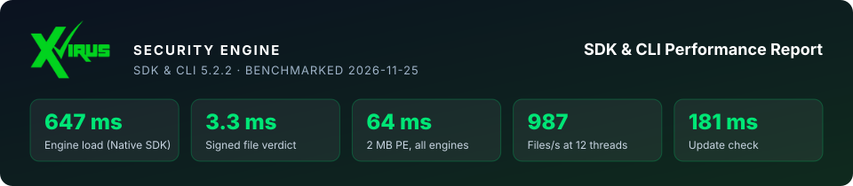
</p>

# Xvirus SDK & CLI 5.2.2 Performance and Resource Usage Report

| | |
|---|---|
| **Products** | Xvirus C# SDK · Xvirus Native SDK · Xvirus Node.js SDK · Xvirus CLI |
| **Version** | 5.2.2 (engine and all bindings) |
| **Benchmark date** | 25 November 2026 |
| **Platform** | Windows 11 x64 · AMD Ryzen 5 7600 (6 cores / 12 threads) · 32 GB RAM · NVMe SSD |
| **Scope** | Engine load · PE and non-PE scans from 4 KB to 32 MB · each detection engine on/off · folder scans · multi-threaded scaling · AI Script (LLM) engine · update checks and database downloads · CPU and memory throughout |

---

## Contents

1. [Executive summary](#1-executive-summary)
2. [The products under test](#2-the-products-under-test)
3. [Test environment and methodology](#3-test-environment-and-methodology)
4. [Engine load: speed, CPU and memory](#4-engine-load-speed-cpu-and-memory)
5. [Scanning PE files](#5-scanning-pe-files)
6. [Scanning non-PE files](#6-scanning-non-pe-files)
7. [AI and heuristics: the cost of each engine](#7-ai-and-heuristics-the-cost-of-each-engine)
8. [Folder scans: throughput and CPU usage](#8-folder-scans-throughput-and-cpu-usage)
9. [Multi-threaded scaling](#9-multi-threaded-scaling)
10. [AI Script engine (LLM)](#10-ai-script-engine-llm)
11. [Checking for and downloading updates](#11-checking-for-and-downloading-updates)
12. [CLI: one-shot vs. interactive mode](#12-cli-one-shot-vs-interactive-mode)
13. [SDK comparison and recommendations](#13-sdk-comparison-and-recommendations)
14. [Tuning guide](#14-tuning-guide)
15. [Appendix: raw data and reproducing the results](#15-appendix-raw-data-and-reproducing-the-results)

---

## 1. Executive summary

All four Xvirus products run the **same scanning engine**. Once the engine is loaded, a scan costs the same whichever product you call it from. The products differ in three ways: how fast they start, how much memory the host runtime needs, and how much throughput they sustain over long scan runs.

| Key result | Value |
|---|---|
| Engine ready to scan | **647 ms** (Native SDK) to **865 ms** (CLI) |
| Memory used by the engine | **≈ 413 MB** with default settings (363 MB with signatures only) |
| Verdict for a digitally signed file, signature fully verified | **3.3 ms** |
| Typical 2 MB executable, all engines on | **61–64 ms** |
| Small files (≤ 64 KB) | **2–4 ms** |
| Throughput with signatures only | **≈ 300 MB/s** for executables, **≈ 340 MB/s** for other files, per thread |
| Folder of 1,000 mixed files, one thread | **194–233 files/s** with all engines · up to **828 files/s** with signatures only |
| Folder of 1,000 mixed files, 12 threads | **987 files/s** (114 MB/s), a 4.3× speed-up |
| AI Script (LLM) analysis of a script | **0.65–1.0 s**, the same on all four products |
| Update check when already up to date | **≈ 180 ms**, < 1 MB of extra memory |
| Full database download (≈ 90 MB) | **2.7–3.4 s** |

**What this means for integrators**

- **Pick the product that fits your stack, not one you hope is faster.** Per-file scan times across the four products are within about 10% of each other (§5, §6), and every product supports every engine, including AI Script.
- **Native and Node.js SDKs start about 25% faster.** They load in about 650 ms versus 850–865 ms for the .NET-hosted products. The Native SDK also has the smallest host footprint, at 3.7 MB before load.
- **The C# SDK and the CLI sustain 14–26% more throughput on long batch scans.** This comes from .NET's runtime optimisation of the hot code (§8).
- **The AI engine is what makes scans CPU-intensive.** With AI on, a single scanning thread uses about 3.5 logical cores. Turning AI off brings that down to under one core (§8).
- **Heuristics set the scan speed for larger files**, at about 35–70 MB/s. Signature-only scanning runs at about 300–340 MB/s (§7).
- **Trusted files are fast and safe.** Digital signatures are verified with Windows' own trust provider, embedded or via Windows' security catalogs. A verified file skips deep analysis; a tampered one does not (§5).
- **Keeping the engine loaded is the most important deployment choice.** Loading costs about 0.9 s. Once loaded, a small file scans in 2–4 ms (§12).

---

## 2. The products under test

Every product wraps the same core engine, built on .NET 8. The engine includes:

- **Signature engine:** MD5 hash lookups against the malware and whitelist databases.
- **Digital-signature trust check:** Authenticode signatures, embedded or from Windows security catalogs, verified with the Windows trust provider. It runs fully offline.
- **Heuristics engine:** pattern matching over file content.
- **AI engine:** an ONNX neural-network model for Windows executables.
- **Optional AI Script engine:** a local large language model for script files.
- **Optional Cloud scan.**

The products differ only in how the engine is packaged and called.

### Xvirus C# SDK

| | |
|---|---|
| **For** | .NET 8+ applications and services (C#, F#, VB.NET) |
| **Form** | Managed library (`CSharpSDK.dll`) referenced directly by your project |
| **Runtime** | .NET 8 runtime (JIT-compiled, tiered compilation with Dynamic PGO) |
| **API** | `XvirusSDK.Load()`, `Scan(path)`, `ScanFolder(path)`, `CheckUpdates()`, `Unload()`, `Settings` |
| **Strengths** | Highest sustained throughput, idiomatic .NET API (results returned as objects and `IEnumerable`), straightforward to parallelise from your own code |
| **Trade-offs** | Needs the .NET runtime. Loads about 200 ms slower than the AOT builds. |

### Xvirus Native SDK

| | |
|---|---|
| **For** | C, C++, Rust, Go, Delphi, Python (ctypes) or any language that can call a C ABI |
| **Form** | Self-contained native DLL (`XvirusSDK.dll`, 9.7 MB), compiled ahead of time with .NET NativeAOT |
| **Runtime** | None. No .NET installation required. |
| **API** | C exports `load`, `scan`, `scanAsString`, `scanFolder`, `scanFolderAsString`, `checkUpdates`, `unload`, `baseFolder`, `version`. Results are C structs with UTF-16 strings, freed by the caller with `LocalFree`. |
| **Strengths** | Fastest load (647 ms). Smallest host footprint (3.7 MB before load). No runtime dependency. Consistent latency from the very first call. |
| **Trade-offs** | 14–25% lower sustained throughput than the C# SDK on long batch scans. The caller manages string memory. |

### Xvirus Node.js SDK

| | |
|---|---|
| **For** | Node.js applications and Electron apps |
| **Form** | Native Node add-on (`XvirusNodeSDK.node`, 10.1 MB, NativeAOT) with an ES-module wrapper (`XvirusNodeSDK.mjs`) |
| **Runtime** | Node.js. No .NET installation required. |
| **API** | `load()`, `scan(path)`, `scanFolder(path)`, `scanFolderAsString(path)`, `checkUpdates()`, `unload()`, `baseFolder(path)`, `version()` |
| **Strengths** | Loads almost as fast as the Native SDK (655 ms). Natural JavaScript API that returns plain objects. |
| **Trade-offs** | Calls are synchronous, so use a worker thread to keep the event loop free during long scans. Throughput is in line with the Native SDK. |

### Xvirus CLI

| | |
|---|---|
| **For** | Scripts, CI pipelines, ops tooling, and integration from languages without an SDK |
| **Form** | Command-line executable (`XvirusCLI.exe`, framework-dependent .NET 8) |
| **Commands** | `l` (load), `s <file>` (scan file), `sf <folder>` (scan folder), `up` (check updates), `v` (version), `i` (interactive mode: commands read line by line from stdin) |
| **Strengths** | No code required. Results come back as JSON. In interactive mode the engine stays loaded and speed matches the C# SDK. |
| **Trade-offs** | One-shot mode pays the full engine load on every call (about 0.9 s). Use interactive mode for anything beyond a few files. |

### Distribution size

Each package is about **115–117 MB** on disk. Of that, about 94 MB is the local-LLM runtime, which is used only by the optional AI Script engine, and about 14 MB is the ONNX runtime used by the AI engine.

The signature, heuristic and AI databases are downloaded separately: about 90 MB, or about 1.07 GB including the optional AI Script model.

---

## 3. Test environment and methodology

### Hardware and software

| Component | Detail |
|---|---|
| CPU | AMD Ryzen 5 7600, 6 cores / 12 threads |
| Memory | 32 GB DDR5 |
| Storage | Samsung 990 PRO NVMe SSD |
| OS | Windows 11 Pro x64 (build 26300) |
| .NET | .NET 8 runtime (C# SDK, CLI) |
| Node.js | v26.13 (Node.js SDK) |
| Other security software | Windows Defender active. The test corpus was pre-read before each run so first-touch scanning did not skew results. |

### Database versions

| Database | Version | Size on disk |
|---|--:|--:|
| Main signature DB | 108 | 70.5 MB |
| Daily signature DB | 15310 | 0.8 MB |
| Whitelist DB | 380 | 8.8 MB |
| Daily whitelist DB | 3039 | 0.3 MB |
| Heuristics DB (PE) | 737 | 0.1 MB |
| Heuristics DB (other files) | 104 | < 0.1 MB |
| Malicious-vendor DB | 89 | < 0.1 MB |
| AI model | 3 | 8.9 MB |
| AI Script model (optional) | 1 | 986 MB |

### Settings used

Every run used the SDK's default `settings.json`. Only the engine switches listed in the profile table below were changed. Cloud scan and archive scanning were **off**, so the results reflect purely local performance.

```json
{
  "EnableSignatures": true,
  "EnableHeuristics": true,
  "EnableAIScan": true,
  "EnableAIScriptScan": false,
  "EnableCloudScan": false,
  "OnlyScanExecutables": false,
  "HeuristicsLevel": 4,
  "AILevel": 10,
  "MaxScanLength": null,
  "MaxHeuristicsPeScanLength": 20971520,
  "MaxHeuristicsOthersScanLength": 10485760,
  "MaxAIScanLength": 20971520,
  "MaxAIScriptScanLength": 1048576,
  "EnableArchiveScan": false,
  "CheckSDKUpdates": true
}
```

**Engine profiles benchmarked**

| Profile | Signatures | Heuristics | AI (PE) | AI Script (LLM) |
|---|:--:|:--:|:--:|:--:|
| **Full** (default) | ✔ | ✔ | ✔ | – |
| **Sig + Heuristics** | ✔ | ✔ | – | – |
| **Sig + AI** | ✔ | – | ✔ | – |
| **Signatures only** | ✔ | – | – | – |
| **Full + AI Script** | ✔ | ✔ | ✔ | ✔ |

The digital-signature trust check is part of every profile.

### Test corpus

| Set | Contents |
|---|---|
| **PE files** | 7 Windows DLLs: 16 KB, 128 KB, 512 KB, 2 MB, 8 MB, 18 MB, 32 MB. Each was made unique so no result came from a cache, a whitelist hash or a signature, and every engine runs. |
| **Non-PE text** | 6 JSON-style log files: 4 KB, 64 KB, 512 KB, 2 MB, 8 MB, 32 MB |
| **Non-PE binary** | 6 random-content files with the same sizes |
| **Signed PE** | An unmodified, Authenticode-signed 163 KB Microsoft executable |
| **Scripts** | 4 benign scripts (`.ps1`, `.bat`, `.js`, `.py`, 0.3–0.6 KB) |
| **Mixed folder** | 1,000 files totalling 121 MB: 250 Windows DLLs (4 KB–6 MB) and 750 web-project files (JavaScript, JSON, Markdown, etc.) |

### How we measured

| Metric | Method |
|---|---|
| **Scan time** | High-resolution timer around a single `Scan()` call. Each file was scanned once as a warm-up, then 7 times (≤ 2 MB), 5 times (8 MB) or 3 times (≥ 18 MB). **Medians** are reported. |
| **Load time** | `Load()` call, 5 runs in fresh processes (steady state) and 3 runs with no prior `rules.json` (first run). Medians are reported. |
| **CPU** | Process CPU time (user + kernel) over the operation. Reported in ms, or as **% of one logical core** (CPU time ÷ wall time, where 100% means one core fully busy). |
| **Memory** | Process **working set** (physical RAM in use) and **private bytes** (committed memory), read from Windows. "Engine footprint" means memory after `Load()` minus the host's own baseline before load. |
| **Host programs** | A minimal host per product: a .NET console app (C# SDK), a C program (Native SDK), a Node.js script (Node.js SDK), and `XvirusCLI.exe` driven over stdin/stdout in interactive mode (CLI). |
| **Folder workload** | Each product's own folder API: `ScanFolder` (C# SDK), `scanFolder` (Native SDK, Node.js SDK) and `sf` (CLI). The folder was scanned twice per run and the second (warm) pass is reported. |

---

## 4. Engine load: speed, CPU and memory

`Load()` reads the signature, whitelist, heuristic and AI databases into memory and prepares the AI model. It is a one-time cost per process.

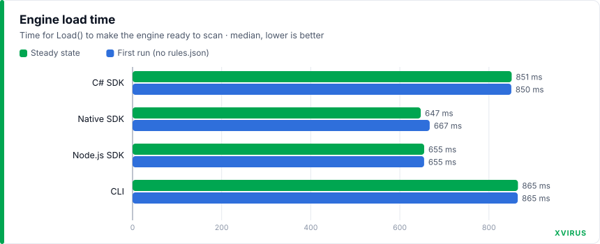

| Product | Load time (ms) | CPU time (ms) | Host baseline (MB) | After load (MB) | Engine footprint (MB) | Peak private (MB) |
|---|--:|--:|--:|--:|--:|--:|
| C# SDK | 851 | 922 | 23.9 | 437 | 413 | 424 |
| **Native SDK** | **647** | **719** | **3.7** | **417** | 413 | **417** |
| **Node.js SDK** | **655** | 734 | 34.6 | 446 | 411 | 441 |
| CLI | 865 | 984 | 21.4 | 433 | 412 | 424 |

*Steady state, median of 5. A first run, with no `rules.json` yet, takes the same time (C# 850 ms, Native 667 ms, Node.js 655 ms, CLI 865 ms).*

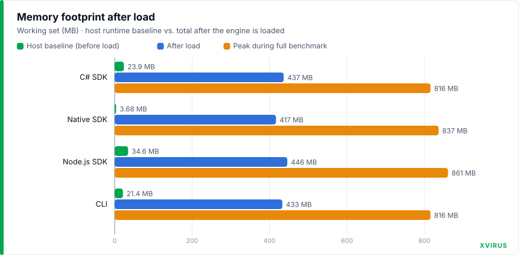

**Findings**

- **The engine footprint is the same everywhere, at about 413 MB.** Memory differences between products come only from the host runtime: 3.7 MB for a native process, 21–24 MB for .NET, and 34.6 MB for Node.js.
- **The NativeAOT products (Native, Node.js) load about 200 ms faster.** Their code is precompiled, so nothing is JIT-compiled at start-up.
- **Loading is CPU-light.** It uses about 0.7–1.0 s of CPU time, roughly one core for the duration of the load.

### Load time and memory by engine profile

Disabling engines you don't need reduces both start-up time and memory.

| Engine profile | C# SDK (ms) | Native SDK (ms) | Node.js SDK (ms) | CLI (ms) | Engine footprint (MB) |
|---|--:|--:|--:|--:|--:|
| Full (Sig + Heur + AI) | 839 | 638 | 643 | 855 | 413 |
| Sig + Heuristics | 773 | 579 | 575 | 785 | 380 |
| Sig + AI | 810 | 614 | 614 | 813 | 397 |
| Signatures only | 736 | 556 | 551 | 754 | 363 |
| Full + AI Script (LLM) | 1,815 | 1,516 | 1,592 | 1,818 | 1,659 ¹ |

*¹ C# SDK. All four products are within 1,661–1,689 MB; see §10.*

The signature databases account for most of the memory: about 363 MB. Turning off the AI model saves about 33 MB and heuristics about 16 MB.

---

## 5. Scanning PE files

Windows executables (PE files) go through every engine. The pipeline is:

1. Signature hash lookup.
2. Digital-signature trust check.
3. Heuristics over the file content.
4. Neural-network AI analysis.

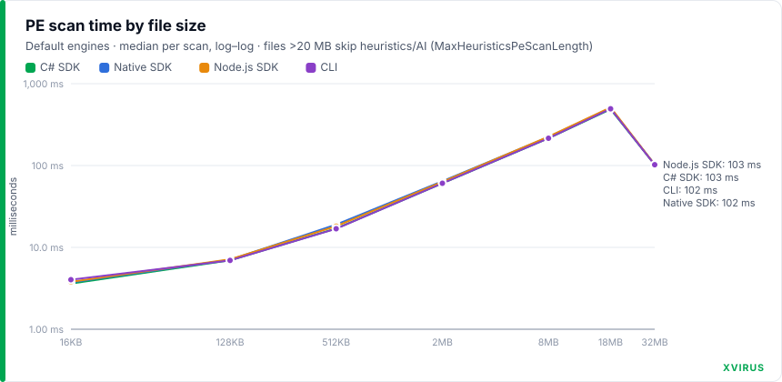

**Median scan time per file, default engines (ms)**

| File size | C# SDK | Native SDK | Node.js SDK | CLI ² | Throughput (MB/s) |
|---|--:|--:|--:|--:|--:|
| 16 KB | 3.62 | 3.74 | 3.80 | 4.03 | 4 |
| 128 KB | 6.96 | 7.06 | 7.16 | 6.93 | 18 |
| 512 KB | 17.0 | 19.0 | 18.1 | 16.9 | 26 |
| 2 MB | 60.8 | 64.4 | 63.3 | 60.8 | 31 |
| 8 MB | 216 | 223 | 226 | 215 | 36 |
| 18 MB | 487 | 504 | 513 | 494 | 36 |
| 32 MB ³ | 103 | 102 | 103 | 102 | 313 |

*² CLI in interactive mode (engine kept loaded). ³ Above the 20 MB default limits for PE heuristics and AI, the file gets the signature and trust checks only. See [§14](#14-tuning-guide).*

**Findings**

- **All four products perform the same.** The spread between fastest and slowest is within about 10% at every size, and within 6% from 2 MB upward.
- **Small executables scan in about 4–7 ms.** That cost is fixed overhead: the AI model inference and the signature trust check.
- **From 512 KB upward, scan time grows linearly with size at about 35 MB/s.** Heuristic pattern matching over the full file dominates in this range (§7).
- **There is no cold-start penalty after load.** The first scan of a file is within a few percent of later scans on every product (see [Appendix](#first-scan-vs-repeat-scan)).

### Digitally signed files: verified trust

When an executable carries a valid signature from a trusted publisher, Xvirus returns a verdict without running heuristics or AI. Signatures are verified with the Windows trust provider, fully offline with no revocation network calls. Two kinds of signature are accepted:

- **Embedded Authenticode signatures**, as used by most third-party software.
- **Windows security catalogs**, which is how most files that ship with Windows are signed.

A file whose embedded signature does not match its contents, for example a tampered copy of a signed program, is **not** trusted and goes through the full analysis.

| Product | Signed PE, 163 KB (ms) | Unsigned PE, 128 KB (ms) | Verdict |
|---|--:|--:|:--:|
| C# SDK | **3.31** | 6.96 | Safe |
| Native SDK | **3.34** | 7.06 | Safe |
| Node.js SDK | **3.33** | 7.16 | Safe |
| CLI | **3.29** | 6.93 | Safe |

In a separate check on the same machine, a random sample of **400 Windows system DLLs** was verified through the Windows catalogs. All 400 were trusted, at a median of **4.7 ms** per file, with no deep analysis needed.

---

## 6. Scanning non-PE files

Documents, logs, archives-as-files, media and other non-executables go through:

1. Signature lookup.
2. A content-heuristics pass, for files up to 10 MB.

The neural-network AI engine applies to executables only.

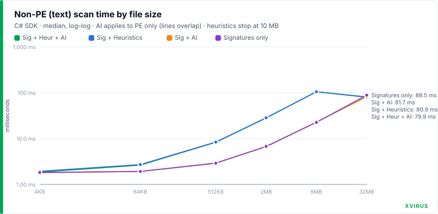

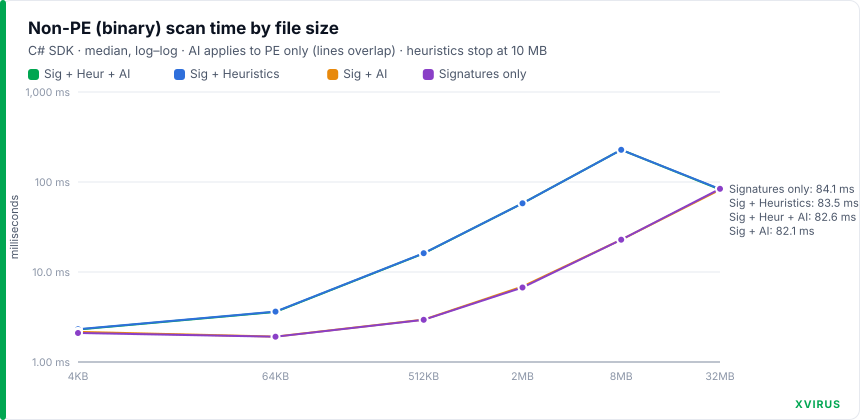

**Median scan time per file, default engines (ms)**

| File size | Text: C# | Text: Native | Text: Node.js | Text: CLI | Binary: C# | Binary: Native | Binary: Node.js | Binary: CLI |
|---|--:|--:|--:|--:|--:|--:|--:|--:|
| 4 KB | 1.86 | 2.26 | 2.22 | 1.94 | 2.29 | 2.58 | 2.59 | 2.32 |
| 64 KB | 2.64 | 3.32 | 3.03 | 2.74 | 3.60 | 4.23 | 4.05 | 3.89 |
| 512 KB | 8.32 | 9.24 | 9.53 | 8.74 | 16.1 | 17.2 | 16.9 | 16.1 |
| 2 MB | 28.2 | 31.0 | 31.1 | 29.0 | 58.0 | 61.3 | 61.0 | 58.4 |
| 8 MB | 105 | 119 | 120 | 106 | 228 | 238 | 240 | 228 |
| 32 MB ⁴ | 79.9 | 80.3 | 80.8 | 80.0 | 82.6 | 89.6 | 83.0 | 82.3 |

*⁴ Above the 10 MB default heuristics limit for non-PE files, only the signature check runs.*

**Findings**

- **Typical documents and small files (≤ 64 KB) take 2–4 ms.**
- **Text files scan about twice as fast as binary content** (about 67 MB/s vs. 34 MB/s with heuristics). The pattern matcher advances faster through low-entropy text.
- **The C# SDK and CLI are 4–12% faster on multi-MB non-PE files.** The .NET JIT optimises the pattern-matching loop slightly better than the AOT build.

---

## 7. AI and heuristics: the cost of each engine

The Native SDK results below show how much each engine adds. The C# SDK, Node.js SDK and CLI show the same pattern; see the [Appendix](#15-appendix-raw-data-and-reproducing-the-results).

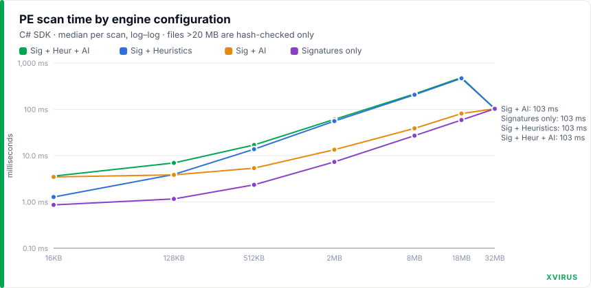

**PE files: median scan time by engine profile (ms, Native SDK)**

| File size | Full (Sig + Heur + AI) | Sig + Heuristics | Sig + AI | Signatures only |
|---|--:|--:|--:|--:|
| 16 KB | 3.74 | 1.14 | 3.24 | 0.81 |
| 128 KB | 7.06 | 4.02 | 3.78 | 1.22 |
| 512 KB | 19.0 | 14.2 | 5.29 | 2.31 |
| 2 MB | 64.4 | 57.7 | 13.1 | 7.26 |
| 8 MB | 223 | 210 | 38.2 | 26.5 |
| 18 MB | 504 | 488 | 81.4 | 60.6 |
| 32 MB | 102 | 109 | 103 | 102 |

**Non-PE files: median scan time by engine profile (ms, Native SDK)**

| File size | Text: with heuristics | Text: without heuristics | Binary: with heuristics | Binary: without heuristics |
|---|--:|--:|--:|--:|
| 4 KB | 2.26 | 2.37 | 2.58 | 2.42 |
| 64 KB | 3.32 | 2.23 | 4.23 | 2.30 |
| 512 KB | 9.24 | 3.45 | 17.2 | 3.30 |
| 2 MB | 31.0 | 7.31 | 61.3 | 7.07 |
| 8 MB | 119 | 22.9 | 238 | 23.2 |

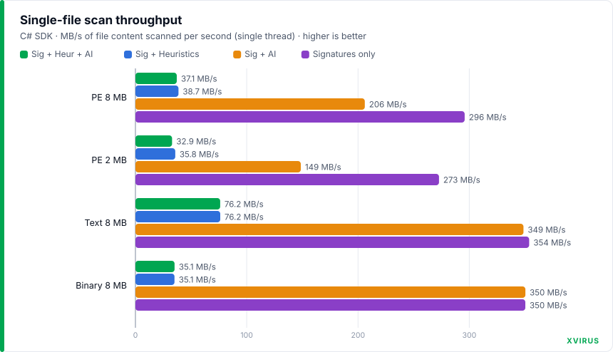

**What each engine costs**

| Engine | Cost per scan | Scales with file size? | Notes |
|---|---|:--:|---|
| **Signatures + trust check** | About 0.8 ms + about 300 MB/s (executables), about 340 MB/s (other files) | Yes, cheaply | Always on. Detects known malware by hash and verifies digital signatures. |
| **Heuristics** | About 35 MB/s (PE, binary), about 70 MB/s (text) | **Yes, and dominant** | Detects malicious patterns in content, including unknown variants. Capped at 20 MB (PE) and 10 MB (other files) by default. |
| **AI (PE only)** | About 2.5 ms fixed + about 1–1.5 ms per MB | Mildly | The neural-network model detects previously unseen executables. Inference uses several threads (§8). |
| **AI Script (LLM)** | 0.65–1.0 s per script | No (scripts ≤ 1 MB) | Optional. Covered in §10. |

**Findings**

- **Heuristics set the scan speed for files above about 256 KB.** Turning heuristics off speeds up a 2 MB PE scan about 5× (64.4 → 13.1 ms) and an 8 MB binary file about 10×.
- **AI is cheap in time on a single file.** It adds about 2.5 ms to a small executable and about 6 ms to a 2 MB one. Its larger cost is CPU, shown in the next section.
- **Signatures-only mode runs at about 300–340 MB/s.** It suits high-volume pre-filtering or file-server sweeps.

---

## 8. Folder scans: throughput and CPU usage

A realistic workload: **1,000 mixed files (121 MB)**, a quarter of them Windows DLLs and the rest typical project files, scanned **on one calling thread** with each product's own folder-scan API.

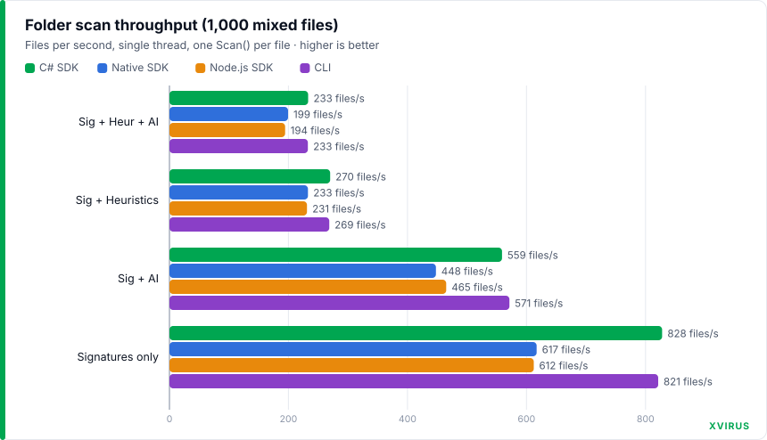

| Engine profile | C# SDK | Native SDK | Node.js SDK | CLI | Native vs. C# |
|---|--:|--:|--:|--:|--:|
| Full (Sig + Heur + AI) | **233 files/s** | 199 files/s | 194 files/s | **233 files/s** | −15% |
| Sig + Heuristics | **270 files/s** | 233 files/s | 231 files/s | 269 files/s | −14% |
| Sig + AI | 559 files/s | 448 files/s | 465 files/s | **571 files/s** | −20% |
| Signatures only | **828 files/s** | 617 files/s | 612 files/s | 821 files/s | −25% |

**Time to scan the 1,000-file folder, default engines:** C# SDK 4.29 s · CLI 4.30 s · Native SDK 5.02 s · Node.js SDK 5.14 s.

### CPU usage

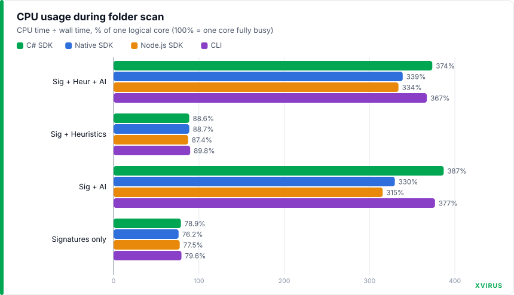

| Engine profile | C# SDK | Native SDK | Node.js SDK | CLI |
|---|--:|--:|--:|--:|
| Full (Sig + Heur + AI) | 374% | 339% | 334% | 367% |
| Sig + Heuristics | 89% | 89% | 87% | 90% |
| Sig + AI | 387% | 330% | 315% | 377% |
| Signatures only | 79% | 76% | 78% | 80% |

*% of one logical core. 100% = one core fully busy. The test machine has 12 logical cores (1,200%).*

### Memory under sustained scanning

| Engine profile | C# SDK | Native SDK | Node.js SDK | CLI |
|---|--:|--:|--:|--:|
| Full: working set after folder scan | 807 MB | 811 MB | 835 MB | 806 MB |
| Full: peak working set (whole run) | 816 MB | 837 MB | 861 MB | 816 MB |
| Signatures only: working set after folder scan | 634 MB | 612 MB | 645 MB | 633 MB |

**Findings**

- **The C# SDK and CLI sustain 14–26% more throughput than the NativeAOT products.** The .NET JIT re-optimises the scan loop with run-time profile data (Dynamic PGO), which ahead-of-time compilation cannot do. The gap is widest when the per-file cost is smallest (signatures only).
- **With AI on, each scanning thread uses about 3.2–3.9 logical cores.** The AI inference runtime parallelises each model evaluation internally. Without AI, scanning stays below one core. On a busy server or an end-user device, the AI setting is the main lever for CPU load.
- **Memory rises from about 415 MB after load to about 610–860 MB during heavy scanning, then levels off.** Large files are read into memory for heuristics and AI, and the runtime keeps those buffers for reuse. A second pass over the same folder added only 7–34 MB, so memory does not keep growing.

---

## 9. Multi-threaded scaling

The engine is thread-safe. The C# SDK was called from a `Parallel.ForEach` over the same 1,000-file folder with all engines enabled.

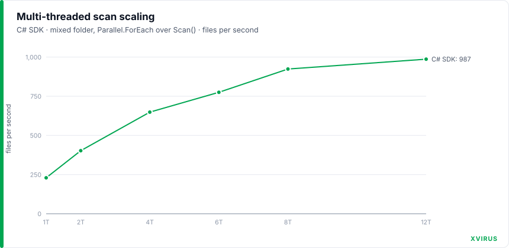

| Threads | Time (ms) | Files/s | MB/s | Speed-up | CPU (% of one core) | Working set (MB) |
|--:|--:|--:|--:|--:|--:|--:|
| 1 | 4,353 | 230 | 26.5 | 1.00× | 373% | 526 |
| 2 | 2,485 | 402 | 46.5 | 1.75× | 527% | 586 |
| 4 | 1,541 | 649 | 74.9 | 2.82× | 736% | 634 |
| 6 | 1,290 | 775 | 89.5 | 3.38× | 824% | 565 |
| 8 | 1,082 | 924 | 107 | 4.02× | 963% | 596 |
| 12 | 1,013 | 987 | 114 | **4.30×** | 1,002% | 635 |

**Findings**

- **Throughput scales well up to the physical core count (6) and keeps improving to 12 threads.** At 12 threads the engine reaches **987 files/s (114 MB/s)** with every engine enabled.
- **Scaling is below linear for a known reason.** AI inference already uses spare cores from a single thread (373% at 1 thread), so extra threads compete for cores that were partly busy already.
- **Memory hardly changes with thread count** (526–635 MB). The databases are shared by all threads, so each extra thread only adds its scan buffers.

Scaling was measured on the C# SDK. The Native and Node.js SDKs share the same engine, so you can likewise call `scan` from several threads or Node.js worker threads.

---

## 10. AI Script engine (LLM)

The AI Script engine is optional. It uses a local large language model to analyse scripts (`.bat`, `.cmd`, `.ps1`, `.py`, `.js`, `.vbs`, up to 1 MB) for malicious intent, catching obfuscated or novel script-based attacks that signatures miss. It runs fully on the CPU, using the fastest instruction set the processor supports (up to AVX-512). **No script content leaves the machine.**

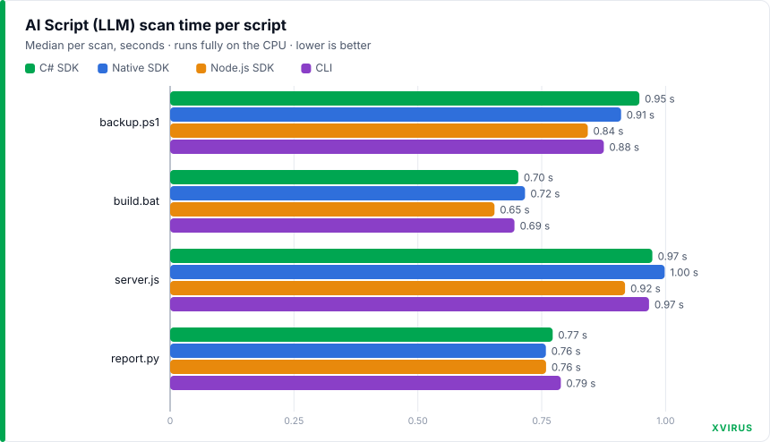

**Median scan time per script (ms)**

| Script | Default engines | C# SDK + AI Script | Native SDK + AI Script | Node.js SDK + AI Script | CLI + AI Script |
|---|--:|--:|--:|--:|--:|
| backup.ps1 | 1.7 | 947 | 910 | **843** | 875 |
| build.bat | 1.6 | 703 | 716 | **655** | 695 |
| server.js | 0.3 | 973 | 998 | **918** | 967 |
| report.py | 1.8 | 772 | **758** | 759 | 789 |

**Resources with the AI Script engine on**

| Product | Load (ms) | Working set after load (MB) | Peak working set (MB) | Peak private (MB) |
|---|--:|--:|--:|--:|
| C# SDK | 1,815 | 1,683 | 2,217 | 1,570 |
| Native SDK | **1,516** | **1,661** | **2,190** | **1,567** |
| Node.js SDK | 1,592 | 1,689 | 2,218 | 1,584 |
| CLI | 1,818 | 1,683 | 2,216 | 1,576 |

**Findings**

- **Every product analyses a script in 0.65–1.0 s**, within about 12% of each other. Scans of PE and non-script files are unaffected (2 MB PE: 60–65 ms with or without AI Script).
- **The engine needs about 1.25 GB of extra memory and about 1 GB of extra disk** for the model, and loading takes about 0.9 s longer.
- **Best for low-volume, high-risk content:** downloaded scripts, email attachments, and scripts about to be executed. It is not meant for bulk-scanning large source trees.

---

## 11. Checking for and downloading updates

`CheckUpdates()` asks the Xvirus cloud for the latest database and SDK versions and downloads only the databases that changed.

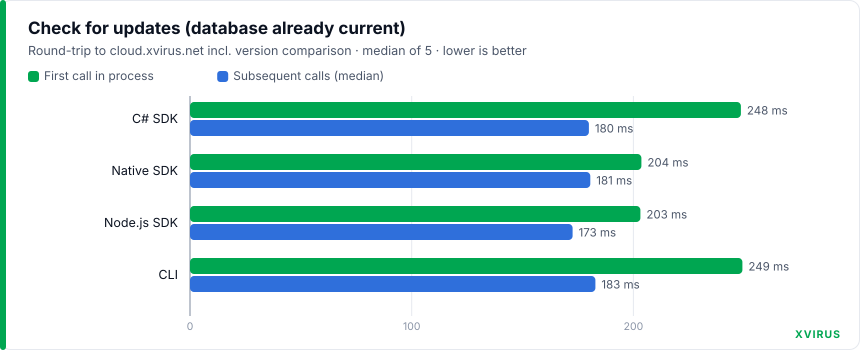

**Update check when everything is already up to date**

| Product | First check in process (ms) | Subsequent checks, median (ms) | CPU (ms) | Memory delta (MB) |
|---|--:|--:|--:|--:|
| C# SDK | 248 | 183 | 16 | < 1 |
| Native SDK | 204 | 182 | < 16 | < 0.1 |
| Node.js SDK | 203 | 174 | < 16 | < 0.1 |
| CLI | 249 | 183 | 16 | 0.6 |
| CLI one-shot (`XvirusCLI up`) | 325 total, incl. process start | – | 156 | 41 MB peak for the process |

*CPU readings below 16 ms are at the resolution of the Windows process timer. The first call in a process includes connection set-up.*

**Fresh installation: downloading every database**

| Scenario | Product | Data downloaded | Time | CPU | Peak working set |
|---|---|--:|--:|--:|--:|
| Default engines | Native SDK | ≈ 90 MB | **2.7 s** | 0.13 s | 21 MB |
| Default engines | Node.js SDK | ≈ 90 MB | **3.4 s** | 0.09 s | 51 MB |
| Default + AI Script model | C# SDK | ≈ 1.07 GB | **23.6 s** | 1.6 s | 46 MB |

**Findings**

- **A routine update check costs about 180 ms of network time and almost no CPU or memory.** It is safe to run on a schedule even on constrained devices. The check does not need the engine loaded (CLI one-shot `up`: 41 MB, 0.3 s).
- **Downloads are streamed to disk.** Even the 1 GB AI Script model download peaked at only 46 MB of working set.
- **Download time depends on bandwidth.** A fresh install of the default databases completes in about 3 s on a fast connection. Later daily updates are much smaller.

---

## 12. CLI: one-shot vs. interactive mode

The CLI can run a single command and exit (one-shot), or stay running and accept commands on stdin (interactive, `XvirusCLI i`).

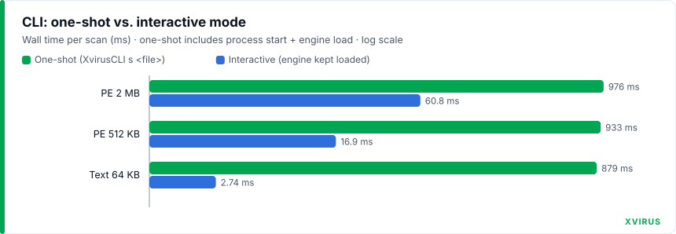

| Command (one-shot) | Wall time (ms) | CPU (ms) | Peak working set (MB) |
|---|--:|--:|--:|
| `XvirusCLI v` (version) | 35 | 31 | 22 |
| `XvirusCLI l` (load only) | 857 | 906 | 447 |
| `XvirusCLI s <file>`: 64 KB text | 879 | 969 | 447 |
| `XvirusCLI s <file>`: 512 KB PE | 933 | 1,125 | 450 |
| `XvirusCLI s <file>`: 2 MB PE | 976 | 1,141 | 451 |
| `XvirusCLI s <file>`: signed PE | 891 | 953 | 446 |
| `XvirusCLI up` (update check) | 325 | 156 | 41 |

| File | One-shot (ms) | Interactive (ms) | Speed-up |
|---|--:|--:|--:|
| 64 KB text | 879 | 2.74 | **320×** |
| 512 KB PE | 933 | 16.9 | **55×** |
| 2 MB PE | 976 | 60.8 | **16×** |

**Findings**

- **In one-shot mode, about 90% of the time goes to process start and engine load.**
- **Interactive mode matches the C# SDK's speed**, for single files and for whole folders (`sf`: 233 files/s with all engines). For any workflow that scans more than a handful of files, start one interactive CLI process and stream commands to it.

---

## 13. SDK comparison and recommendations

### At a glance

| | C# SDK | Native SDK | Node.js SDK | CLI |
|---|:--:|:--:|:--:|:--:|
| **Engine load** | 851 ms | **647 ms** | 655 ms | 865 ms |
| **Host memory before load** | 24 MB | **3.7 MB** | 35 MB | 21 MB |
| **Memory after load** | 437 MB | **417 MB** | 446 MB | 433 MB |
| **2 MB PE scan** | **60.8 ms** | 64.4 ms | 63.3 ms | **60.8 ms** |
| **64 KB file scan** | **2.6 ms** | 3.3 ms | 3.0 ms | 2.7 ms |
| **Signed file verdict** | 3.3 ms | 3.3 ms | 3.3 ms | 3.3 ms |
| **Folder, all engines (1 thread)** | **233 files/s** | 199 files/s | 194 files/s | **233 files/s** |
| **Folder, signatures only (1 thread)** | **828 files/s** | 617 files/s | 612 files/s | 821 files/s |
| **AI Script, per script** | 0.70–0.97 s | 0.72–1.00 s | **0.65–0.92 s** | 0.69–0.97 s |
| **Update check** | 183 ms | 182 ms | 174 ms | 183 ms |
| **Runtime dependency** | .NET 8 | **none** | Node.js | .NET 8 |
| **Language reach** | .NET | **any (C ABI)** | JavaScript / TypeScript | **any (process)** |

### Where the differences come from

| Difference | Cause | Practical impact |
|---|---|---|
| Native / Node.js load about 25% faster | Ahead-of-time compiled. No JIT at start-up. | Matters for short-lived processes and fast app launch. |
| C# / CLI sustain 14–26% more throughput | The JIT's Dynamic PGO optimises the hot scan loop at run time. | Matters for bulk and scheduled scans of many files. |
| Host memory 3.7 MB vs. 21–35 MB | Native process vs. .NET runtime vs. V8 runtime | Small next to the engine's about 413 MB. |
| Per-file latency equal (within about 10%) | Same engine and the same native components (hashing, ONNX, llama.cpp, Windows trust provider) | Interactive and on-access scanning feel the same on every product. |

### Which product to choose

| If you are building… | Recommended | Why |
|---|---|---|
| A .NET service, desktop app or server-side scanner | **C# SDK** | Best throughput, idiomatic API |
| A C / C++ / Rust / Go / Delphi / Python product, or you can't ship .NET | **Native SDK** | Zero runtime dependency, fastest start, smallest host footprint |
| An Electron app or Node.js backend | **Node.js SDK** | Native JS API, fast start. Run scans on a worker thread. |
| CI/CD gates, ops scripts, or integration from other languages without code | **CLI (interactive mode)** | No integration code. Same speed as the C# SDK once loaded. |
| Ad-hoc single-file checks | **CLI one-shot** | Simplest to use, at about 0.9 s per call |

---

## 14. Tuning guide

| Goal | Setting | Effect (from this benchmark) |
|---|---|---|
| **Lowest CPU usage** | `EnableAIScan: false` | Cuts CPU per scanning thread from about 3.5 cores to under 1 core. Small PE scans go from about 3.7 ms to about 1.1 ms. |
| **Maximum throughput on large files** | `EnableHeuristics: false`, or lower `MaxHeuristicsPeScanLength` / `MaxHeuristicsOthersScanLength` | Turns about 35 MB/s into about 200–340 MB/s |
| **Lowest memory** | Signatures only | Engine footprint 363 MB instead of 413 MB |
| **Scan only executables** | `OnlyScanExecutables: true` | Skips non-PE files entirely |
| **Bulk scanning** | Call `Scan` from N threads (N ≈ logical cores) | Up to 4.3× faster at 12 threads |
| **Deep script inspection** | `EnableAIScriptScan: true` | About 0.65–1.0 s per script on every product, +1.25 GB RAM, +1 GB disk |
| **Skip very large files** | `MaxScanLength` | Caps time spent on large media and archives |
| **Keep the engine warm** | Load once and reuse. CLI: interactive mode. | Avoids the about 0.9 s load per call |

**Default size limits.** PE files over 20 MB and other files over 10 MB get the signature and trust checks only. This is why the 32 MB files in this report scan faster (about 80–100 ms) than the 8 MB and 18 MB files. Raise the limits for deeper inspection of large files, at about 35 MB/s of extra scan time per MB.

---

## 15. Appendix: raw data and reproducing the results

### First scan vs. repeat scan

Time for the first scan of a file right after load, compared with the median of later scans (ms).

| File | C# SDK first / repeat | Native SDK first / repeat | Node.js SDK first / repeat | CLI first / repeat |
|---|--:|--:|--:|--:|
| 2 MB PE | 63.3 / 60.8 | 64.4 / 64.4 | 64.4 / 63.3 | 62.0 / 60.8 |
| 64 KB text | 2.8 / 2.6 | 3.1 / 3.3 | 3.5 / 3.0 | 2.8 / 2.7 |
| Signed PE | 16.3 / 3.3 | 15.6 / 3.3 | 15.5 / 3.3 | 16.5 / 3.3 |

*The first signature verification in a process takes about 16 ms while Windows initialises its trust provider. Every later one takes about 3.3 ms.*

### Peak working set per run, by engine profile

| Engine profile | C# SDK (MB) | Native SDK (MB) | Node.js SDK (MB) | CLI (MB) |
|---|--:|--:|--:|--:|
| Full (Sig + Heur + AI) | 816 | 837 | 861 | 816 |
| Sig + Heuristics | 772 | 750 | 776 | 769 |
| Sig + AI | 788 | 779 | 813 | 805 |
| Signatures only | 683 | 664 | 694 | 682 |
| Full + AI Script | 2,217 | 2,190 | 2,218 | 2,216 |

### Folder scan detail, every product and profile

| Profile | Product | Time (ms) | Files/s | MB/s | CPU % core | Working set after (MB) |
|---|---|--:|--:|--:|--:|--:|
| Full | C# SDK | 4,292 | 233 | 26.9 | 374 | 807 |
| Full | Native SDK | 5,017 | 199 | 23.0 | 339 | 811 |
| Full | Node.js SDK | 5,143 | 194 | 22.4 | 334 | 835 |
| Full | CLI | 4,299 | 233 | 26.9 | 367 | 806 |
| Sig + Heur | C# SDK | 3,702 | 270 | 31.2 | 89 | 700 |
| Sig + Heur | Native SDK | 4,296 | 233 | 26.9 | 89 | 679 |
| Sig + Heur | Node.js SDK | 4,327 | 231 | 26.7 | 87 | 707 |
| Sig + Heur | CLI | 3,724 | 269 | 31.0 | 90 | 696 |
| Sig + AI | C# SDK | 1,789 | 559 | 64.5 | 387 | 777 |
| Sig + AI | Native SDK | 2,233 | 448 | 51.7 | 330 | 774 |
| Sig + AI | Node.js SDK | 2,150 | 465 | 53.7 | 315 | 808 |
| Sig + AI | CLI | 1,750 | 571 | 66.0 | 377 | 800 |
| Signatures | C# SDK | 1,208 | 828 | 95.6 | 79 | 634 |
| Signatures | Native SDK | 1,621 | 617 | 71.2 | 76 | 612 |
| Signatures | Node.js SDK | 1,633 | 612 | 70.7 | 78 | 645 |
| Signatures | CLI | 1,218 | 821 | 94.8 | 80 | 633 |

### Data files

| File | Contents |
|---|---|
| [`results/summary.json`](results/summary.json) | Aggregated results behind every table and chart in this report |
| [`results/tables.md`](results/tables.md) | Every result table, generated from `summary.json` |
| [`results/environment.json`](results/environment.json) | Hardware, runtime, database versions and package sizes |
| [`results/raw/`](results/raw/) | Per-run raw measurements (JSON) |
| [`charts/`](charts/) | All charts as SVG |

### Reproducing

The harness is in [`harness/`](harness/). It needs Windows x64, the .NET 8 SDK, Node.js, Python 3 and a C compiler (MinGW `gcc`).

```powershell
# 1. Publish each product (from the repository root)
dotnet publish NativeSDK -c Release -r win-x64 -o <work>\pub\native
dotnet publish NodeSDK   -c Release -r win-x64 -o <work>\pub\node
dotnet publish XvirusCLI -c Release -r win-x64 --self-contained false -o <work>\pub\cli
dotnet publish Benchmarks\harness\csharp-host -c Release -o <work>\pub\csharp

# 2. Build the native host, the corpus, and run everything
$env:XV_BENCH_WORK = "<work>"
cd Benchmarks\harness
gcc -O2 -o $env:XV_BENCH_WORK\pub\native\native_host.exe native-host\native_host.c -lpsapi
py -3 make_corpus.py
py -3 run_benchmarks.py env
py -3 run_benchmarks.py fresh-update
py -3 run_benchmarks.py load
py -3 run_benchmarks.py profiles
py -3 run_benchmarks.py cli-oneshot
py -3 run_benchmarks.py scaling

# 3. Aggregate, chart and tabulate
py -3 make_report.py
py -3 make_tables.py
```

Results depend on CPU, storage, other security software and network conditions. Relative comparisons between products and engine profiles are more portable than absolute numbers.

---

<p align="center">
  <br>
  <sub>© 2026 Xvirus · SDK &amp; CLI 5.2.2 Performance Report · All measurements taken on the hardware described in §3.</sub>
</p>
